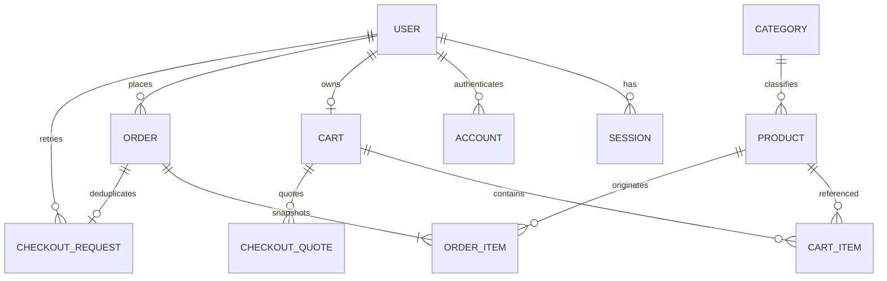

# Database design — proposed

M4 backend adds the reviewed `202611240001_cart` migration: Cart (unique TEXT userId, UUID id, revision) and CartItem (unique cartId/productId, quantity SQL check 1–99). User deletion cascades its cart/lines; product deletion is restricted. Cart writes serialize cart creation and mutations under a row lock, then lock the affected product. GET is read-only with a consistent snapshot. Quotes/orders remain unimplemented design below.

M2 implements the auth-base and category/product schema and two migrations. M3 uses these existing auth tables for registration and seven-day absolute sessions; no additional migration was required. Cart tables/workflows are implemented in M4; quote/order tables below remain future design. Auth base was generated with Better Auth 1.7.26; `prisma/auth.generated.prisma` preserves the reference, while `schema.prisma` adds explicit output/native timestamps and catalog. No real account was created by the assistant; synthetic verification fixtures were removed afterward.

Generated auth IDs are text (not UUID). Role remains a library-compatible string with a SQL CUSTOMER/ADMIN check and default CUSTOMER; public assignment is disallowed and M3 enforces signup/session authorization at runtime. Domain category/product IDs are UUID. Additional SQL checks and the case-insensitive auth-email unique index are maintained in migrations because Prisma schema alone cannot express all of them.

## Relationships

## Auth-owned records

Better Auth user: library-compatible ID, name, normalized unique email, emailVerified, optional image, timestamps. Add a server-controlled role enum CUSTOMER/ADMIN, default CUSTOMER; never permit public signup to set it. Domain tables reference the generated user ID type (do not assume UUID for library IDs).

Session: library-managed unique token, user FK, expiry, timestamps and library metadata. Account: credential/password hash and provider identity fields managed by the library. Verification: library-generated token/expiry records as required by enabled auth functionality. No plaintext passwords or hand-rolled session tables. Recovery/verification delivery remains future scope; remove unavailable actions from UI. The demo must not imply unverified email ownership is confirmed.

## Commerce records

Domain IDs are server-generated UUIDs. Timestamps are timestamptz in UTC, rendered in the viewer's locale. Required strings have explicit length checks in request schemas and database columns.

| Table | Principal fields and constraints |
| --- | --- |
| category | id PK; name varchar(100); slug varchar(120) unique; createdAt, updatedAt |
| product | id PK; categoryId FK RESTRICT; name varchar(160); slug varchar(180) unique; description text (API max 5000); imagePath varchar(300); priceMinor integer > 0 and ≤ 100000000; stock integer ≥ 0; status DRAFT/ACTIVE/ARCHIVED; version integer ≥ 0; timestamps |
| cart | id PK; userId unique FK; revision integer ≥ 0 default 0; timestamps |
| cart_item | id PK; cartId FK CASCADE; productId FK RESTRICT; quantity integer 1–99; unique(cartId,productId); timestamps |
| checkout_quote | id PK; cartId FK; userId FK; cartRevision; lineSnapshot JSONB; totalMinor; currency MYR; expiresAt; createdAt |
| order | id PK; userId FK RESTRICT; status CONFIRMED/PROCESSING/SHIPPED/DELIVERED; paymentMode SIMULATED; currency MYR; subtotalMinor,totalMinor ≥ 0; shippingMinor,taxMinor = 0; recipientName,addressLine1,city,postalCode,country snapshots; version; timestamps |
| order_item | id PK; orderId FK CASCADE; productId FK RESTRICT; productName; unitPriceMinor; quantity 1–99; lineTotalMinor; unique(orderId,productId) |
| checkout_request | id PK; userId FK; key varchar(100); requestHash; orderId unique FK; createdAt; unique(userId,key) |

Auth user deletion is not a public MVP action. Commerce history must not disappear with account changes. Archive products rather than deleting them; ordered products are protected by FK restrictions. Delete categories only if unused. Never expose cascading order deletion through the API. Specify quote/cart cleanup without deleting order history before broad public use.

Use SQL CHECK constraints for quantities, nonnegative stock, allowed statuses, positive prices and monetary bounds. Prisma migrations may need explicit SQL for checks and locking; review that SQL. Ensure order lineTotal = unitPrice × quantity and total = subtotal + shipping + tax in service rules plus suitable row-level checks. Aggregate sum across order items is enforced transactionally by the service and tested, not implied to be an ordinary cross-table CHECK.

Money is integer sen. At most 100 distinct lines, each 99 units, unit price at most 100000000 sen; totals can exceed a PostgreSQL integer. Use bigint for line/order/quote totals, convert explicitly to bounded safe JS numbers in DTOs; maximum proposed order is 990000000000 sen, below Number.MAX_SAFE_INTEGER. Do not accidentally serialize JS BigInt directly to JSON. Test exact arithmetic and bounds. No floating-point rounding determines prices.

Indexes: products(status,categoryId,createdAt,id); products(priceMinor,id) if query plans warrant; orders(userId,createdAt,id), orders(status,createdAt,id); cart-item unique pair; session/library-required indexes; quote(userId,expiresAt); checkout-request unique user/key. Use bounded case-insensitive text search initially; consider PostgreSQL full-text/trigram indexing only after measuring. Paginated sort uses ID as deterministic tie-breaker.

## Cart consistency

Every cart mutation creates/finds the unique user cart, locks its row, then changes lines and increments revision. Retry concurrent first creation after unique conflict, outside the failed transaction. Lock/check product before validating stock. All cart writers and checkout follow cart → products sorted by ID lock ordering; inventory/admin updates lock affected product rows and use version checks. Never reserve stock merely by adding to cart.

An empty cart GET has no side effects. Add merges by ID; PATCH replaces quantity; DELETE removes. Concurrent operations are serialized under the cart lock, avoiding lost updates. Cart responses include revision, currency, current product availability, integer money, totals, and any unavailable-line warning. Inactive items can be displayed as unavailable and removed, but cannot be purchased.

## Quote and checkout transaction

1. Authenticated quote POST locks cart and reads active product rows consistently in stable ID order. Validate nonempty cart, ≤100 lines, quantities/stock and money bounds. Store server-only line snapshot, revision, user, MYR total and expiry five minutes from creation; return the quote summary. A quote does not reserve stock or guarantee future availability.
2. Checkout POST receives quoteId, shipping and an Idempotency-Key. Hash validated canonical input; scope keys to user. Reuse the same key and body when retrying an uncertain result. A changed quote/shipping intent requires a new key.
3. In one DB transaction lock cart; recheck existing user/key under that lock. Existing matching hash returns the saved order even if quote expired/cart now empty; mismatched hash returns 409. The unique constraint is a second guard.
4. Require quote ownership, unexpired quote and matching cart revision/content. Lock all product rows in sorted ID order. Recheck active state, price, stock and quantities. If price/content changed, return 409 QUOTE_CHANGED and require a fresh review; if insufficient stock, return 409 STOCK_CONFLICT. No partial purchase.
5. Compute amounts server-side. Conditionally decrement stock (`stock >= requested`) and check affected rows, write immutable order and item/shipping snapshots, save checkout_request, clear lines, increment cart revision. Commit all changes together, then return the order. No external network calls inside transaction.
6. Roll back on any failure. Retry only recognized transient deadlock/serialization failures a bounded number of times with the same intent; never indiscriminately retry validation failures. Unique-conflict handling must restart the transaction, not continue in an aborted PostgreSQL transaction.

Keep successful idempotency records for the MVP order lifetime. If retention changes later, document the retry window. Reusing a consumed quote with a new key fails because cart revision changed. Parallel requests for the same cart cannot both purchase its old contents. Different customers racing for one unit are serialized by the product lock/conditional decrement. Verify both with real independent database connections, not mocks.

## Order changes

Admin status PATCH requires expectedVersion, permitted next status, and transactional compare/update. Increment version; conflicting writers get 409. Customer reads the same order row updated by admin, avoiding separate unsynchronized seller states. Inventory adjustments use an integer delta plus expectedVersion rather than silently overwriting a concurrently changed stock count. Cancellation/refunds/restocking are deliberately absent from the MVP status enum.

## Migrations and verification

Create migrations only after approval. Generate auth schema, inspect it, then add commerce migrations; seed fresh synthetic categories/products and explicit local test identities. Test migrations on an empty DB and upgrade fixture; seed must refuse production by default. Use separate credentials/DBs for integration tests. Test constraints directly, rollback after an injected mid-checkout failure, last-unit races, repeated keys/different bodies, snapshot stability, quote expiry and concurrent admin edits.

Reference: [Prisma transaction guidance for the proposed v7 compatibility line](https://www.prisma.io/docs/orm/v7/prisma-client/queries/transactions). Confirm actual APIs against the pinned version at implementation.
