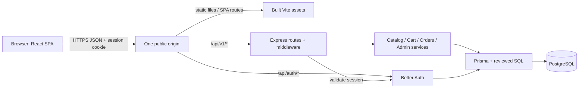

# System architecture — proposed

Architecture approved on 19 November 2026. M1 implements shell/routing; M2 adds catalog database/API; M3 enables registration, absolute cookie sessions, current role/CSRF infrastructure and account UI. M4 adds catalog/detail/cart UI and owned cart storage/API. Checkout/orders and admin management sections below remain future work. See [M3 record](MILESTONE_3.md).

## Stack recommendation and alternatives

| Concern | Recommendation and reason | Alternative and trade-off |
| --- | --- | --- |
| Frontend | React + TypeScript + Vite; explicit browser/API boundary, quick local feedback | Next.js simplifies integrated hosting/SSR but introduces server/client framework concepts; revisit for SEO |
| Navigation | React Router with actual catalog/detail/cart/order/admin URLs | Modal-only UI is simpler initially but weaker for refresh, deep links, and test isolation |
| Styling | Tailwind, a small set of reusable form/layout components | CSS modules avoid utilities; either works, choose one convention |
| Backend | Node.js supported LTS + Express + TypeScript, one modular service | Spring Boot fits existing Java knowledge but adds a second language/toolchain; Fastify adds schemas/plugins; Nest adds more framework concepts |
| Database | PostgreSQL; relationships, constraints, transactions | SQLite simplifies local start but differs from target concurrent DB; MongoDB is less aligned with relational orders |
| Data access | Prisma with reviewed SQL migrations and explicit compatible versions | Drizzle exposes SQL more directly and is a good alternative; raw SQL maximizes SQL learning but adds mapping work |
| Auth | Better Auth email/password and database-backed sessions | Managed auth reduces operations but creates provider coupling; custom password/JWT code creates avoidable security work |
| Validation | Zod at HTTP boundaries; shared request/response contracts | TS alone does not validate untrusted JSON |
| Tests | Vitest/Testing Library, Supertest, Playwright; real PostgreSQL integration | Mock-only tests are fast but cannot verify SQL locks/rollback |
| Repository | npm workspaces, `apps/web`, `apps/api`, small `packages/contracts` | Separate repos add release coordination; Nx/Turborepo unnecessary at this size |

Use fetch plus feature hooks and React context for session/UI needs initially. Do not add Redux or a query-cache library until a demonstrated need. Share API contracts, never Prisma entities or database credentials with the browser.

## System diagram



One modular monolith, one database, no microservices, queue server, Redis, or payment network. During development Vite proxies `/api` to Express. In initial production Express serves Vite output and the API from one Render origin; SPA fallback must never swallow unknown `/api` routes.

## Target structure (M1 creates only the foundation)

```text
Cartiva/
  apps/
    web/
      src/
        app/                 # router, providers, layout
        components/ui/       # accessible reusable primitives
        features/
          auth/ catalog/ cart/ checkout/ orders/ admin/
        lib/                 # fetch wrapper, money formatting
      public/                # newly supplied/created assets only
    api/
      src/
        app.ts               # compose middleware/routes, testable without listen
        server.ts            # startup/shutdown, environment validation
        config/
        lib/                 # database, auth, logger
        middleware/          # session, role, validation, errors, CSRF
        modules/
          catalog/ cart/ checkout/ orders/ admin/
      prisma/                # schema, versioned migrations, synthetic seed
      tests/integration/
  packages/contracts/src/    # small DTO/schema exports
  tests/e2e/
  docs/
  .github/workflows/
```

Each backend module has routes, request schemas, service, and focused data-access functions when needed. Controllers translate HTTP; services own business rules and transaction boundaries; Prisma handles persistence. Avoid generic base repositories and interface-per-class abstractions.

## Frontend hierarchy

```text
AppProviders
  Router
    StoreLayout (Header, Navigation, StatusRegion, Footer)
      CatalogPage (SearchBar, CategoryFilter, SortSelect, ProductGrid, Pagination)
      ProductPage (ProductDetails, AddToCartForm)
      AuthPage (SignInForm / SignUpForm)
      CartPage (CartLine, QuantityControl, CartSummary)
      CheckoutPage (ShippingForm, QuoteSummary, PlaceOrderButton)
      OrderListPage / OrderDetailPage
    AdminRouteGuard (UX convenience; API is the authority)
      AdminLayout
        ProductListPage / ProductEditorPage / CategoriesPage
        OrderListPage / OrderEditorPage
```

Catalog query state belongs in URL parameters. Server responses own product/cart/order truth. Local React state owns pending inputs and feedback. When a mutation succeeds, use its returned cart or refetch; do not calculate an authoritative total from stale UI data. Session provider derives identity from the server, not a trusted local role flag.

## Authentication and authorization

Better Auth owns password hashing, session issuance/expiry/revocation and auth-specific tables/routes. The proposed Prisma adapter has a compatibility constraint: official docs currently require Prisma 7 and state Prisma 8 is unsupported. Pin a tested compatible set at Milestone 1; do not use unbounded `latest` dependencies. [Adapter documentation](https://better-auth.com/docs/adapters/prisma).

The Express auth handler must be mounted before JSON body parsing, with the route syntax matching the selected Express major. [Integration documentation](https://better-auth.com/docs/integrations/express).

Cookie sessions are HttpOnly and Secure in production, SameSite=Lax for the single-origin design, host-scoped. Use a seven-day maximum session lifetime with explicit expiry/revocation tests; configure session caching conservatively so logout and role changes are effective. Public sign-up always creates CUSTOMER. Provision ADMIN with an explicit local operator command, never a public role parameter or committed password. Read current server-side role for every admin operation.

Better Auth provides password/session and auth-route origin protection, but application `/api/v1` mutations need their own protection. Require exact configured Origin, JSON content type and a session-bound CSRF token on POST/PUT/PATCH/DELETE. Reject missing/untrusted origins on browser mutations. GET must not mutate application state. A safe GET may return an unpersisted empty cart; create it on mutation. [Auth security documentation](https://better-auth.com/docs/reference/security).

## Request walkthrough

Click Add → React sends validated product ID/quantity → Express resolves session and checks CSRF → schema validates JSON → cart service locks/updates the customer's cart and checks product status/stock → PostgreSQL constraints enforce invariants → API returns canonical cart → React renders updated totals. Browser prices/roles/customer IDs never authorize or price anything.

Checkout obtains a quote, then submits shipping, quote ID, and idempotency key. A transaction locks the cart, locks products in stable ID order, verifies quote/cart/prices/stock, writes snapshots/order, decrements stock, clears cart, and records the key atomically. See [database design](DATABASE_DESIGN.md).

## Validation, errors, and security

Reject unknown mutation fields; validate IDs, bounded text, safe integers, finite prices, pagination and sort enums. Escape/render text using normal React interpolation; do not render product descriptions as raw HTML. Allow only relative trusted asset paths in MVP, no arbitrary HTML/image fetch pipeline. Limit request size and login/signup/mutation rates. Single-process demo rate limiting is acceptable only while deployment is one instance; scaling requires shared enforcement.

Use typed domain errors, central HTTP mapping, request IDs and redacted logs. Never return stack traces, SQL, password hashes, cookies, session tokens, or full shipping addresses in logs. Validate required secrets at startup. Parameterize queries, including any raw SQL locks; apply least-privilege DB credentials. Configure trusted proxy behavior for the actual host before deriving client IP or secure cookie state.

## Testing and deployment

Unit: quantity/money/status rules. HTTP integration: auth/CSRF/validation/ownership. Real isolated PostgreSQL: migrations, unique constraints, transaction rollback, duplicate checkout, last-unit race, same-cart concurrent edits. Browser: customer purchase → admin fulfillment → customer observes status; mobile and keyboard checks. Never point tests at personal/prod data.

CI runs clean install from lockfile, lint/typecheck, unit/integration tests with PostgreSQL service, production builds, then browser tests against built apps. Deployment runs reviewed forward migrations once before compatible app startup; readiness verifies DB connectivity. Back up before schema changes; rehearse restore with synthetic data. Separate local/test/production databases and secrets. Keep a manual deploy gate initially.

Recommended first host: Render serves SPA+API, Neon supplies PostgreSQL with a modest connection pool and TLS. [Render web services](https://render.com/docs/web-services), [Neon pooling](https://neon.com/docs/connect/connection-pooling). Render free services sleep after inactivity, so a portfolio demo may cold-start; no always-on/free promise is made. [Free-tier limits](https://render.com/docs/free).

Vercel can host Vite static output, but split unrelated domains introduce cross-site cookie constraints. Use a verified same-origin reverse proxy for both `/api/auth` and `/api/v1`, or shared same-site custom domains with narrow CORS and credentials; test cookies, redirects, Origin validation and logout in production before choosing it. [Vite deployment guide](https://vite.dev/guide/static-deploy). This alternative is not configured now.
